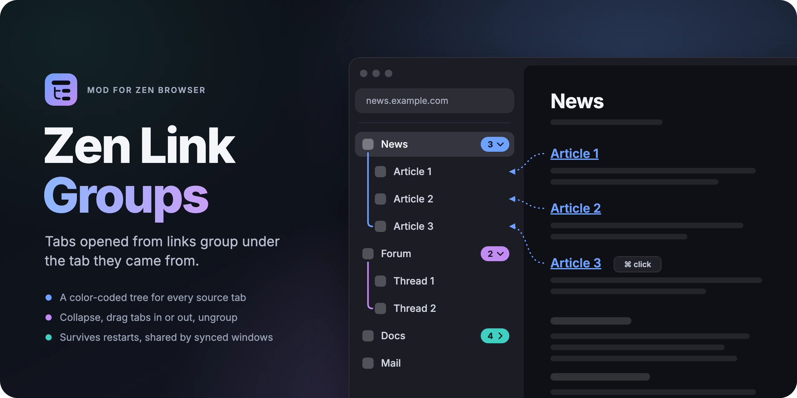
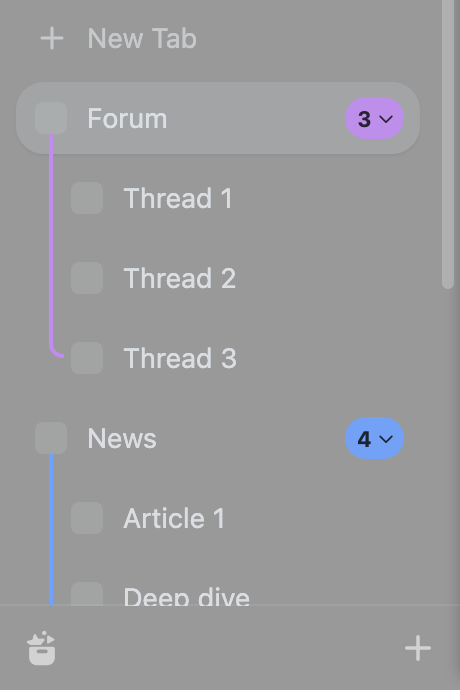
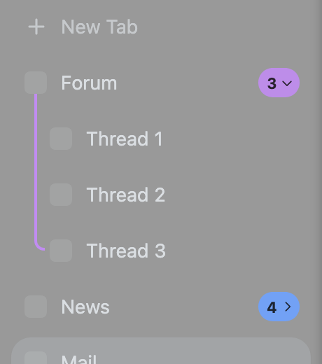

<p align="center">
  
</p>

# Zen Link Groups

[](https://github.com/robertgontarski/zen-link-groups/actions/workflows/ci.yml)
[](LICENSE)

A mod for the [Zen](https://zen-browser.app) browser. Tabs opened from links line up under the tab they came from, the way they do in Dia, so you can always see where a tab came from.

<p>
  
  
</p>

The banner is an illustration. The two images above are real screenshots, taken by the end-to-end test.

## What it does

- **Grouping.** A link opened in a new tab lands under the tab it was opened from, indented and joined by a colored line. Every group gets its own color. It works with cmd+click, middle click, `target=_blank` links and "Open Link in New Tab".
- **Flat groups.** A link opened from a child tab joins the same group, as in Dia and in Chrome's tab groups.
- **Collapsing.** The parent tab carries a badge with the number of tabs. Clicking it collapses or expands the group. The selected tab stays visible even in a collapsed group.
- **Drag and drop.**
  - A child dragged out of the group leaves it.
  - A tab dropped into the middle of a group joins it.
  - A dragged parent takes its children along.
- **Closing the parent.** The first child takes over the group and keeps its color. A group left with a single tab disappears.
- **Pinned parent and Essentials.** The children stay grouped in the tab list, and the parent is marked in the group's color.
- **Glance.** A link clicked in a Glance preview joins the group of the tab the preview was opened from. A Glance opened as a regular tab joins that group too.
- **Tab context menu.** It gains *Collapse / Expand group*, *Remove from group*, *Ungroup* and *Close group*. A pinned parent stays open; only its children close. The labels are in English, or in Polish when the browser runs in Polish.
- **Persistence.** Groups survive a browser restart and reopening a closed tab (Cmd+Shift+T). They show up in every synced Zen window.
- **Collapsed sidebar.** Instead of a tree, grouped tabs get an outline in the group's color.

The mod does not group tabs opened by hand (Cmd+T, the address bar), pinned tabs, Essentials, tabs in a split view, or tabs from a different space than the parent.

## Install

Requirements: macOS and Zen 1.24 or newer in `/Applications/Zen.app`. The mod was tested on Zen 1.24.3b (Gecko 160).

```sh
git clone https://github.com/robertgontarski/zen-link-groups.git
cd zen-link-groups

# 1. Quit Zen (Cmd+Q).
./install.sh --dry-run   # optional: shows what would be copied, changes nothing
./install.sh
# 2. Start Zen.
```

Zen's native mods are CSS only, which is also why this mod is not in the Zen Mods store. Grouping needs JavaScript, so the installer adds the [fx-autoconfig](https://github.com/MrOtherGuy/fx-autoconfig) loader. A copy of it lives in `vendor/fx-autoconfig`, pinned to the commit recorded in `vendor/fx-autoconfig/VERSION`.

| Where | What |
| --- | --- |
| `Zen.app/Contents/Resources/config.js`<br>`Zen.app/Contents/Resources/defaults/pref/config-prefs.js` | the loader (two files inside the app) |
| `<profile>/chrome/utils/` | the rest of the loader |
| `<profile>/chrome/JS/zenLinkGroups.uc.js`<br>`<profile>/chrome/JS/zen-link-groups/` | the mod |
| `<profile>/chrome/CSS/zenLinkGroups.uc.css` | its styles |
| `<profile>/zen-link-groups.json` | saved groups (the mod creates this file itself) |

By default the installer picks the profile this Zen install starts with (`installs.ini`). Point it at another one with `--profile "<profile directory>"`. If the app already has a different `config.js`, the installer keeps it as `config.js.backup-<date>`.

> The loader gives scripts in `<profile>/chrome/JS` full browser privileges. Keep only code you trust there.

**After a Zen update.** An update can replace the app's files, the loader included. If groups stop working, quit Zen and run `./install.sh` again.

**When macOS blocks writing to Zen.app.** Open *System Settings → Privacy & Security → App Management*, enable your terminal there and run the installer again.

**If you use [Sine](https://github.com/CosmoCreeper/Sine).** Sine is not supported yet, and you should not run `install.sh` next to it. Sine keeps its own bootloader in the same place inside the app (`config.js` and `defaults/`), and the installer would replace it, leaving the old `config.js` as a backup. Sine also loads only the scripts a mod declares in its `theme.json`, from `chrome://sine/content/<mod id>/`, while this mod imports its modules from fx-autoconfig's `chrome://userscripts/content/`.

### Uninstall

```sh
./install.sh --uninstall
```

This removes the mod and the saved groups. The loader is removed only when no other scripts are left in `chrome/JS` and `chrome/CSS` and its files are identical to the copy in this repository.

## Customizing the look

The variables sit in `:root` at the top of `src/CSS/zenLinkGroups.uc.css`:

| Variable | Meaning | Default |
| --- | --- | --- |
| `--zlg-indent` | indent of the child tabs | `18px` |
| `--zlg-line-x` | position of the line, measured from the parent's left edge (the middle of its icon) | `19.5px` |
| `--zlg-line-width` | thickness of the line | `2px` |
| `--zlg-elbow-reach` | where the curve into the last child ends | `8px` |
| `--zlg-c0` … `--zlg-c7` | the group palette (`light-dark(light, dark)`) | |

After a change, run `./install.sh` and restart Zen.

## How it works

- **Parent.** When Firefox opens a tab from a link, it sets `tab.openerTab` on that tab. The mod reads the value on the `TabOpen` event.
- **Tab identity.** The key is Zen's `tab.id`. Zen saves it in the session as `zenSyncId`, and a tab has the same id in every synced window. That lets one shared state (`store.sys.mjs`, saved to `zen-link-groups.json`) serve all windows and survive a restart.
- **Drag and drop.** After a tab is dropped, the mod derives membership from the tab order (`reconcileSection` in `model.sys.mjs`). Only the window you are working in recomputes it. The other windows, into which Zen mirrors tab moves, only repaint.
- **Look.** The controller sets `zlg-*` attributes on the tabs and the CSS draws from them. The indent reuses `--zen-folder-indent`, the variable Zen uses for folders.

```text
src/JS/zenLinkGroups.uc.js              window controller: tab events, drag and drop, rendering, menu
src/JS/zen-link-groups/model.sys.mjs    pure group logic (no browser APIs)
src/JS/zen-link-groups/store.sys.mjs    state shared by all windows, and saving it
src/CSS/zenLinkGroups.uc.css            indents, lines, colors, badge
vendor/fx-autoconfig/                   pinned copy of the loader
test/                                   unit and end-to-end tests
```

## Tests

```sh
node --test test/*.test.mjs                  # group logic, 20 tests
python3 -I test/e2e.py --out /tmp/zlg-e2e    # end to end on a real Zen, headless
```

The end-to-end test does not touch your profile or `Zen.app`. It starts Zen through Marionette on a temporary profile, turns the loader on in the running browser and clicks real links. It checks 15 scenarios, including drag and drop, the context menu, a second window and a restart, and saves sidebar screenshots to the `--out` directory. With `--headed` you can watch the browser window. It needs only Python 3 (standard library).

CI runs the unit tests and lints the installer. The end-to-end test needs macOS with Zen installed, so it runs locally only.

## Known limitations

- The line position matches Zen's default tab look. A theme or another mod that changes tab spacing may need `--zlg-line-x` adjusted.
- A collapsed group hides its tabs with CSS. Dragging other tabs right next to a collapsed group can insert them between the hidden tabs. When in doubt, expand the group before dragging.
- The parent is detected only at the moment a tab opens. The mod will not group tabs that were opened before it was installed.

## License

[MPL-2.0](LICENSE). The bundled fx-autoconfig loader in `vendor/fx-autoconfig` is MPL-2.0 as well and ships with its own license file.

This project is not affiliated with Zen Browser or Dia.
